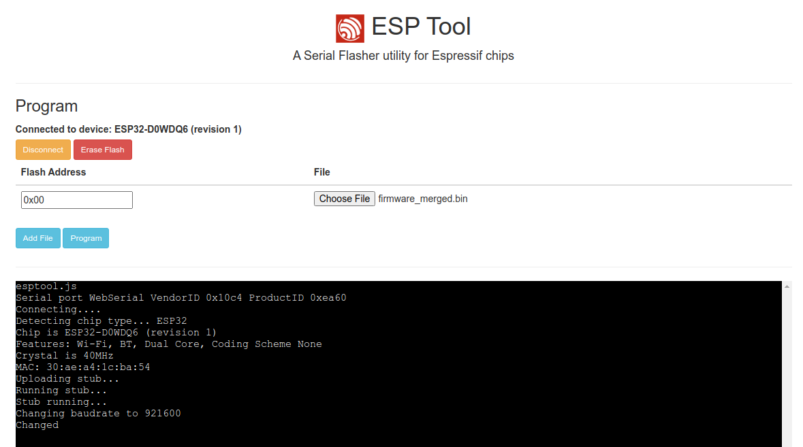
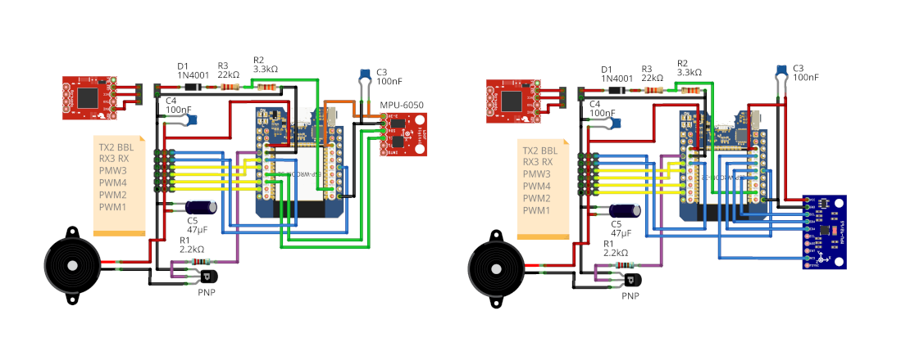

# ESP-FC Flight Controller

ESP-FC is an open-source flight controller firmware for hobbyists who want to build their own drone electronics. It runs on inexpensive and widely available ESP32 and ESP32-S3 boards, works with common SPI/I2C gyro modules, and is compatible with Betaflight Configurator and Blackbox Explorer. Thanks to built-in WiFi and ESP-NOW support, it can be configured wirelessly and even used without a separate radio receiver.

# Features

* Espressif targets (ESP32, ESP32-S3)
* ESC protocols (PWM, Oneshot125/42, Multishot, Brushed, Dshot150/300/600 bidirectional)
* PPM, SBUS, IBUS and CRSF Receivers
* Built-in ESP-NOW receiver and WiFi configuration
* SPI and I2C gyro modules support (MPU6050, MPU9250, ICM20602, ICM42688, BMI160)
* Flight modes (ACRO, ANGLE, AIRMODE)
* Frames (Quad X)
* Betaflight configuration tool compatible ([app.betaflight.com](https://app.betaflight.com/))
* Configurable Gyro Filters (LPF, Dynamic Notches, dTerm, RPM)
* Blackbox log recording (OpenLog/OpenLager/Flash)
* Up to 4kHz gyro/loop on ESP32 with SPI gyro
* MSP and CLI protocol interface
* Resource/Pin mapping
* In-flight PID Tuning
* Buzzer, LED and voltage monitor
* Failsafe mode

# Documentation

In this repository you can find firmware code that allows you to build your own ESP32-based flight controller. For convenience, it mimics Betaflight 2026.06, so it can be configured using the [online Betaflight Configurator](https://app.betaflight.com/). It can also be used to analyze blackbox logs. In most aspects it is similar to Betaflight, so many configuration and tuning tips are helpful here too. However, be aware that this software is not the same as Betaflight; there are some limitations and differences in functionality and performance.

> [!IMPORTANT]
> Before you begin, **read the following documentation carefully!**

 * [Wiring Guide](/docs/wiring.md)
 * [Setup Guide](/docs/setup.md)
 * [Full Documentation](/docs/README.md)

Join our **[Discord Channel](https://discord.gg/jhyPPM5UEH)** to get help.

# Quick Start

## Requirements

Hardware:
* ESP32 or ESP32-S3 board
* MPU9250 SPI or MPU6050 I2C gyro (GY-88, GY-91, GY-521 or similar)
* PDB with 5V BEC
* RC receiver (PPM, SBUS, IBUS or CRSF)
* Buzzer and some electronic components (optional)

Software:
* [Betaflight Configurator](https://app.betaflight.com/) (online version, Chrome or Edge browser)
* [CH340 USB-to-serial converter driver](https://sparks.gogo.co.nz/ch340.html) or similar for boards with a USB bridge

## Flashing

1. Download and unpack the selected firmware from the [Releases Page](https://github.com/rtlopez/esp-fc/releases)
2. Visit the [ESP Tool Website](https://espressif.github.io/esptool-js/)
3. Click "Connect" and choose the device port in the dialog
4. Add the firmware file and set Flash Address to `0x00`
5. Click "Program"
6. After successful flashing, power cycle the board

## Setup

After flashing, you need to configure a few things first:

 1. Configure the pinout according to your wiring, especially pin functions. You can find more information in the [CLI Reference](/docs/cli.md)
 2. Connect to [Betaflight Configurator](https://app.betaflight.com/) and set it up according to your preferences
 3. Test motors without propellers
 4. Have fun ;)

> [!NOTE]
> Not all functions displayed in the configurator are available in the firmware. The rule of thumb is that if you cannot change a specific option in Betaflight Configurator, it is not supported. It usually rolls back to the previous value after saving. It is strongly recommended to follow the [setup guide](/docs/setup.md).

## Wiring diagrams

## Supported Modules

 * **ESP32** - recommended
 * **ESP32-S3** - recommended
 * **ESP32-S2** - experimental
 * **ESP32-C3** - experimental, limited performance, no FPU
 * **RP2350** - experimental, partially works
 * **RP2040** - experimental, limited performance, no FPU
 * **ESP8266** - obsolete, no longer developed

> [!NOTE]
> Experimental targets don't support all features and may be unstable.

## Supported Sensors and Protocols

 * Gyro: MPU6050, MPU6500, MPU9250, ICM20602, ICM42688, BMI160
 * Barometers: BMP180, BMP280, SPL06
 * Magnetometers: HMC5883, QMC5883, AK8963, QMC5883P
 * Receivers: PPM, SBUS, IBUS, CRSF/ELRS
 * ESC Protocols: PWM, BRUSHED, ONESHOT125, ONESHOT42, MULTISHOT, DSHOT150, DSHOT300, DSHOT600
 * GPS: M8, M9, F9 & M10
 * Other protocols: MSP, CLI, BLACKBOX, ESPNOW

## Issues

You can report issues using the GitHub [tracker](https://github.com/rtlopez/esp-fc/issues).
You can also join our [Discord Channel](https://discord.gg/jhyPPM5UEH).

## Development

* Visual Studio Code
* [PlatformIO](https://platformio.org/install/ide?install=vscode) extension
* Git

## License

This project is distributed under the MIT License. Bear in mind that:

THE SOFTWARE IS PROVIDED "AS IS", WITHOUT WARRANTY OF ANY KIND, EXPRESS OR
IMPLIED, INCLUDING BUT NOT LIMITED TO THE WARRANTIES OF MERCHANTABILITY,
FITNESS FOR A PARTICULAR PURPOSE AND NONINFRINGEMENT. IN NO EVENT SHALL THE
AUTHORS OR COPYRIGHT HOLDERS BE LIABLE FOR ANY CLAIM, DAMAGES OR OTHER
LIABILITY, WHETHER IN AN ACTION OF CONTRACT, TORT OR OTHERWISE, ARISING FROM,
OUT OF OR IN CONNECTION WITH THE SOFTWARE OR THE USE OR OTHER DEALINGS IN THE
SOFTWARE.

## Donations
If you like this project and want it to keep being developed, you can support me a little.

* BTC: 1Lopez7yPtbyjfLGe892JfheDFJMMt43tW
* LTC: LV3G3sJxz9AYpDMYUp8e1LCmerFYxVY3ak
