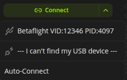
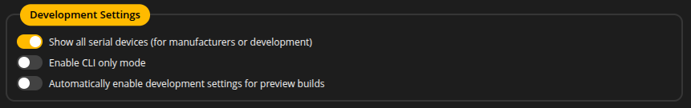
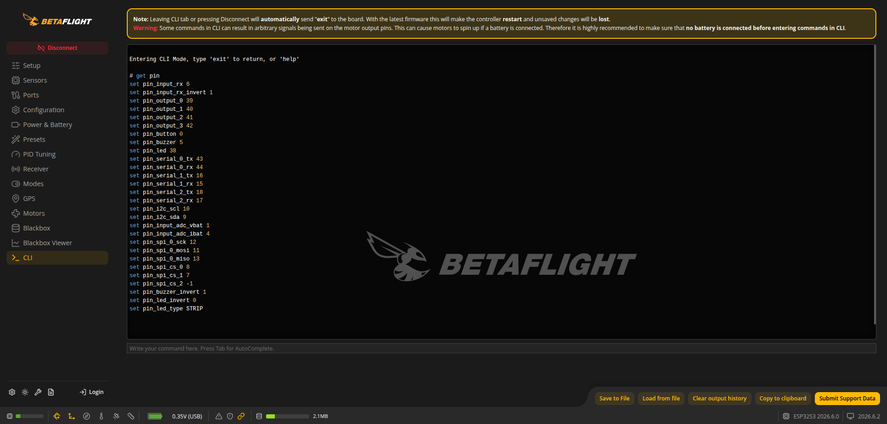
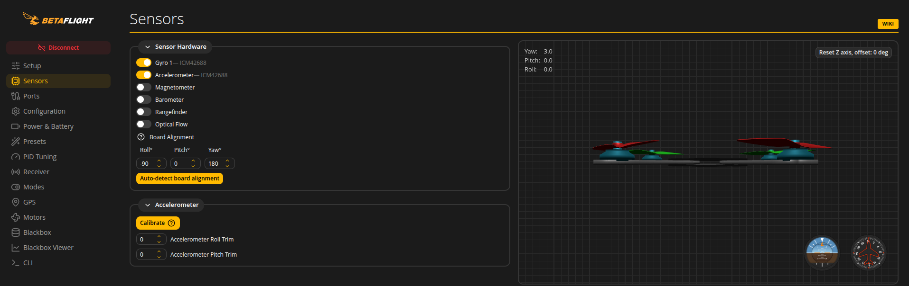

# Setup

This page describes the steps that are absolutely required before the first flight.

## Connecting to Betaflight Configurator

Open [Betaflight Configurator](https://app.betaflight.com/) in the browser. It must be a Chromium-based browser (Chrome, Edge, Brave, etc.).

The **Connect** button with a dropdown allows you to select your device.



The first time, you may need to click `--- I can't find my device ---` to see all available serial devices. If you still can't see your device, click the gear icon in the bottom left corner and make sure `Show all serial devices` is enabled in the settings.



> [!NOTE]
> On Linux systems, you might need to add your user to the `dialout` group to access the serial port:
> ```
> sudo usermod -aG dialout $USER
> ```
> then log out and log in again.

Then select your device from the list and click **Connect**.

> [!NOTE]
> Not all functions displayed in the configurator are available in the firmware. The rule of thumb is that if you cannot change a specific option in Betaflight Configurator, it is not supported. It usually rolls back to the previous value after saving.

## Configure wiring

Go to the `CLI` tab and type `get pin`. This command shows which pins are assigned to specific functions. If your wiring is different, you can make adjustments here.



For more details, see [Pin Functions CLI Reference](/docs/cli.md#pin-functions)

## Gyro calibration

Go to the `Sensors` tab and ensure that the model in the preview moves exactly the same way as yours. If not, go to the `Configuration` tab and configure `Board Alignment`.



After the adjustment, make sure that your model is in a level, steady position. Then click the **Calibrate** button in the Accelerometer section and wait a few seconds. Do not move the model during the calibration process.

> [!CAUTION]
> Board Alignment is crucial for proper calibration and flight performance. Incorrect alignment will lead to uncontrolled spinning.

## System configuration

In the `Configuration` tab, set `PID loop frequency`. Recommended values are 1kHz to 2kHz. For I2C gyro setups, 1kHz is the maximum recommended.

> [!NOTE]
> Keep an eye on the CPU load displayed at the bottom; it shouldn't exceed 50%.

## Receiver setup

It is recommended to use a serial-based receiver (SBUS, IBUS, CRSF). You need to allocate a UART port for it. You can do it in the `Ports` tab by ticking the switch in the `Serial Rx` column.

Then go to the `Receiver` tab and select `Receiver mode` and `Serial Receiver Provider`.

To use the ESP-NOW receiver, choose the "SPI Rx (e.g. built-in Rx)" receiver mode in the Receiver tab. You need a compatible transmitter module. Read more about [ESP-FC Wireless Functions](/docs/wireless.md).

> [!NOTE]
> ESP-NOW is mostly for micro drones and is not recommended for bigger setups due to limited range and reliability.

## Motor setup

In the `Motors` tab, you must configure:

### Mixer

You can select the mixer type here. This configuration depends on the type of aircraft you are configuring.

**Important!** If you build a multirotor, you must ensure that:

1. Each motor number is connected to the correct output and placed in the correct position on your aircraft, relative to the gyro orientation shown in the picture.
2. Each motor rotates in the correct direction, as shown in the image.

> [!CAUTION]
> If these conditions aren't met, your quad will go crazy on the first start and may cause damage or even injury.

To verify that, you can enable **test mode** and spin each motor individually. To do that:
1. remove all propellers,
2. connect the battery,
3. click "I understand the risk...",
4. move the slider of a given motor to spin it.

If you are using any analog protocol (PWM, OneShot, Multishot), you also need to calibrate your ESCs here. To do that:
1. click "I understand the risk...",
2. move the master slider to the highest value,
3. connect the battery,
4. when the ESCs play calibration beeps, move the master slider down to the lowest value,
5. the ESCs should play confirmation beeps.

> [!NOTE]
> Only Quad X is supported at the moment. The motor direction wizard is not supported; you must configure your ESCs separately. The easiest way to change direction is swapping motor wires.

### Motor direction is reversed

This option informs the FC that your motors rotate in the reverse direction. This option doesn't reverse the motor direction. It has to be configured with an ESC configurator or by swapping motor wires.

### ESC protocol

Here you can select the protocol that your ESC supports. For multirotors, it is recommended to use `DSHOT150` or `DSHOT300`. Older ESCs may not support digital protocols; in this case, it is recommended to use at least `OneShot125`. The `Brushed` protocol is for driving brushed motors through FET drivers.

> [!WARNING]
> It is not recommended to use `PWM` for multirotors. Setups that use this protocol are hard to tune.

### Motor PWM speed separated from PID speed

This option allows you to set the PWM frequency independently of the PID loop, e.g. when the PID loop runs at 1kHz but the ESC accepts a maximum of 333Hz. PWM is limited to 480Hz.

## Flight modes

Flight modes can be configured in the `Modes` tab.

### Arm

This mode must be enabled to be able to fly. When the quad is armed, the motors spin (unless the Motor Stop option is enabled).

### Angle

By default, ACRO mode is engaged if no flight mode is active. This mode enables self-leveling. In this case, you control the tilt angle of the multirotor instead of the rotation rate. It affects only the Roll and Pitch axes. The Yaw axis behaves the same way as in Acro mode.

### Air mode

Increases the range of control at extreme throttle positions. Recommended to enable; it can be controlled by the same RC channel as Arm to get permanent behaviour. It activates when the throttle reaches about 40% and remains active until disarmed.

### Buzzer

Activates the buzzer, for example to find a lost model in high grass.

### Failsafe

Triggers the failsafe procedure.

## Blackbox

It is possible to collect flight data in two ways: via a `serial port` or to the `onboard flash`.

Onboard flash can store about 2.5MB of data. This is equivalent to 2-3 minutes of flight. It should be enough for tuning.

If you need more, choose `Serial Port` and a serial logging device such as [OpenLager](https://github.com/d-ronin/openlager) or [OpenLog](https://github.com/sparkfun/OpenLog). To configure it:
1. In the `Ports` tab, select `Blackbox logging` in the Peripherals column on a free UART.
2. Then in the `Blackbox` tab, select `Serial Port` or `Onboard flash` as the `logging device`.

> [!NOTE]
> The port speed from the `Configuration/MSP` column is used, and the same speed must be set in the logging device _(this might change in future versions)_.

Recommended settings:

- To log at 1k rate, you need a device capable of receiving data at 500kbps.
- To log at 2k rate, you need 1Mbps.

OpenLager can handle it easily. If you plan to use OpenLog, you might need to flash [blackbox-firmware](https://github.com/cleanflight/blackbox-firmware) to be able to handle more than 115.2kbps. Both 250kbps and 500kbps work well with modern SD cards up to 32GB in size.

## Limitations

### Configuration tab

`AirMode` is only available in the Modes tab. If you want to enable it permanently, use the same control channel as ARM.

### Failsafe tab

Only the "Drop" Stage 2 procedure is supported.

### GPS tab

You can change only the `GPS for navigation and telemetry` and `Set Home point once` options and view the GPS status. All other options are configurable via the CLI tab only.

CLI commands are described on the [GPS Setup](./gps.md) page.

### Presets tab

Presets aren't supported; do not try to apply any of them.

### PID Tuning tab

1. There is only one PID profile, one rate profile and one battery profile
2. Feed-forward settings have no effect
3. I-term rotation has no effect
4. Dynamic damping has no effect
5. Throttle boost has no effect
6. Miscellaneous settings have no effect
7. Anti-gravity settings have no effect
8. Dynamic notch requires a PID loop of at least 1kHz

> [!NOTE]
> Apart from that, most Betaflight PID and filter tuning principles apply here. Keep in mind, however, that very aggressive tuning tips are not recommended and might lead to different results.

### Receiver

1. Not all protocols are implemented, currently only PPM, CRSF, SBUS, IBUS
2. Only CRSF telemetry and `rssi_adc` are supported
3. RC deadband applies to RPY, no separate Yaw deadband

### Modes

Only "Add Range" works; "Add Link" is not supported.

### Adjustments

Not implemented. As a replacement, you can use [pid scaler CLI](/docs/cli.md#scaler-configuration).

### Servos

Not implemented. As a replacement, you can use [output CLI](/docs/cli.md#output-channel-config) to change the output protocol and rate.

### Motors

No 3D features, only Quad-X Mixer.

### Video transmitter

Not yet implemented, work in progress.

### OSD

Not implemented, but MW_OSD should work via a serial port and the MSP protocol.
