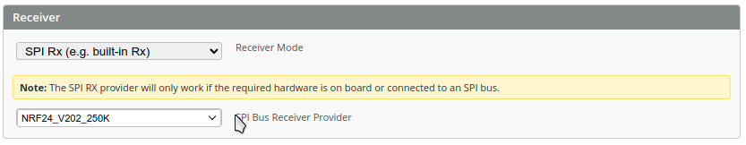
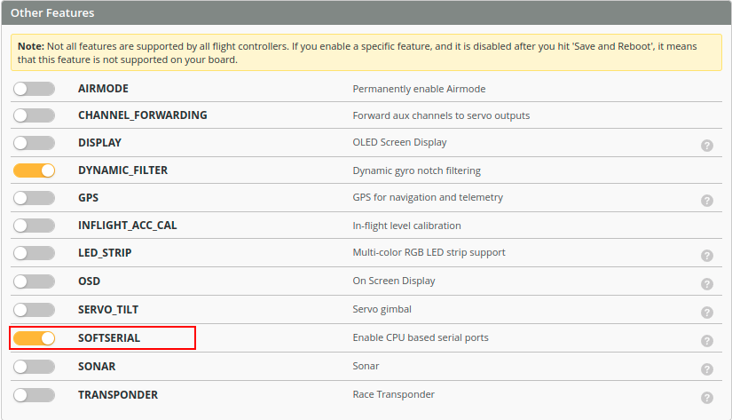
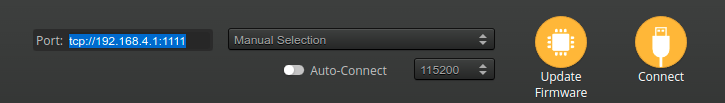

# ESP-FC Wireless functions

Espressif modules have a built-in WiFi module that can be used for configuration and control.

## ESP-NOW control

ESP-NOW is a proprietary wireless communication protocol defined by Espressif, which enables direct, quick and low-power control of smart devices without the need for a router.

As there are no real transmitters using this protocol on the market, you have to build your own transmitter module first. If you already own an RC transmitter with a JR bay, you can use another ESP32 module. In this case, follow the [espnow-rclink-tx](https://github.com/rtlopez/espnow-rclink-tx) instructions.

In ESP-FC, you have to choose `SPI Rx (e.g. built-in Rx)` as the Receiver mode in the Receiver tab.



Transmitter and receiver bind automatically after power up; you don't need to do anything. The recommended startup procedure is:
1. turn on the transmitter first
2. next, power up the receiver/flight controller

## WiFi configuration

> [!NOTE]
> To be able to configure the device using a WiFi connection, you need to enable the `SOFTSERIAL` function. WiFi can only be used to configure the device. While WiFi is active, it is not possible to arm the controller, and a reboot is required.



WiFi starts its own access point if the board does not detect a receiver signal for at least 30 seconds (i.e. it stays in failsafe mode since boot). The name of this AP is `ESP-FC` and it is an open network. After connecting to this AP, choose `Manual Selection` and enter `tcp://192.168.4.1:1111`.



You can also automatically connect ESP-FC to your home network. To achieve that, go to the CLI tab and enter your network name and password.
```
set wifi_ssid MY-HOME-NET
set wifi_pass MY-HOME-PASS
```
> [!NOTE]
> - The network name and password must not contain spaces.
> - ESP-NOW may not work when connected to a home network.

Then you can check the connection status by typing `wifi` in the CLI tab.
```
wifi 
ST IP4: tcp://0.0.0.0:1111
ST MAC: 30:30:F9:6E:10:74
AP IP4: tcp://192.168.4.1:1111
AP MAC: 32:30:F9:6E:10:74
```
In this mode, you need to find the IP address assigned by DHCP. The `ST IP4` line shows the address that you need to use in the configurator. If it shows `0.0.0.0`, the FC was not able to connect to the home network.
