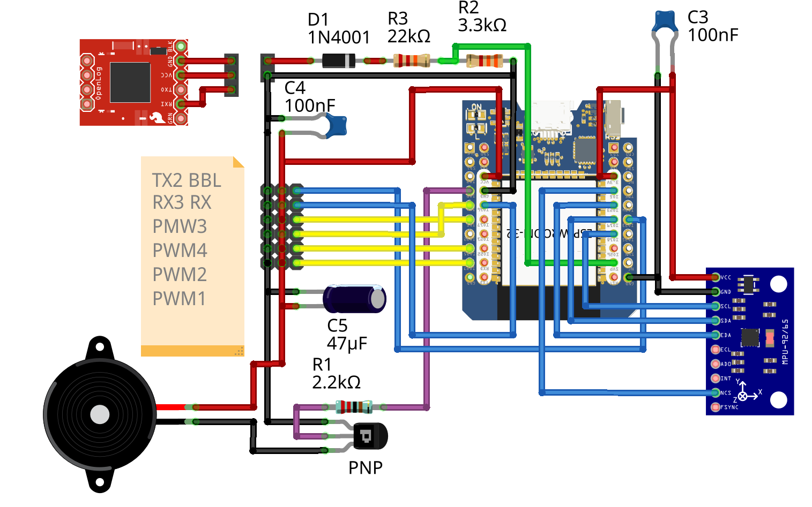
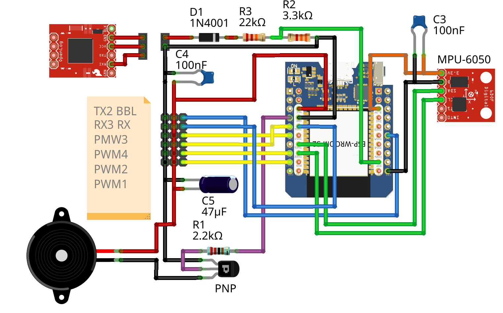

# ESP-FC wiring examples and PIN mapping

ESP32 MCUs allow pin remapping, so the wiring is not final and you can remap inputs and outputs to your needs. To change a pin function, go to the CLI and use the `get pin` command to check the current assignment. For example, to set the first output to pin 1, use the command:

`set pin_output_0 1`

To unmap a pin function, use `-1` as the pin number:

`set pin_output_3 -1`

> [!NOTE]
> There are still some limitations in remapping. Not all pins can be used with all functions. Some pins are input only, others are strapping pins and may prevent the board from booting if used incorrectly. Please consult the MCU documentation for available options. The default layout is proven to work.

## Default I2C pin mapping for gyro modules

| Module Pin | CLI Name         | ESP32 | ESP32-S3 |
|------------|------------------|------:|---------:|
| SCK/SCL    | `pin_i2c_scl`    | 22    | 10       |
| SDA/SDI    | `pin_i2c_sda`    | 21    | 9        |

> [!NOTE]
> The I2C driver accepts only pins 1 to 31.

## Default SPI pin mapping for gyro modules

| Module Pin  | CLI Name         | ESP32 | ESP32-S3 |
|-------------|------------------|------:|---------:|
| SCK/SCL     | `pin_spi_0_sck`  | 18    | 12       |
| SDA/SDI     | `pin_spi_0_mosi` | 23    | 11       |
| SAO/SDO/ADO | `pin_spi_0_miso` | 19    | 13       |
| NCS         | `pin_spi_cs_0`   |  5    |  8       |
| CSB*        | `pin_spi_cs_1`   | 13    |  7       |
| -           | `pin_spi_cs_2`   | -     | -        |

**Note:** `CSB` is required for the barometer on some 10-DOF modules, e.g. MPU-9250.

> [!TIP]
> For better performance, prefer SPI wiring.

## Default Servo/Motor output mapping

| Motor  | CLI name       | ESP32 | ESP32-S3 |
|-------:|----------------|------:|---------:|
| 1      | `pin_output_0` | 27    | 39       |
| 2      | `pin_output_1` | 25    | 40       |
| 3      | `pin_output_2` | 4     | 41       |
| 4      | `pin_output_3` | 12    | 42       |

> [!NOTE]
> ESP32 supports up to 8 outputs (`pin_output_4` - `pin_output_7`); they are unmapped (-1) by default.

## Default UART/Serial pin mapping

| UART | CLI name          | ESP32 | ESP32-S3 |
|-----:|-------------------|------:|---------:|
| RX 1 | `pin_serial_0_rx` |  3    | 44       |
| TX 1 | `pin_serial_0_tx` |  1    | 43       |
| RX 2 | `pin_serial_1_rx` | 32    | 15       |
| TX 2 | `pin_serial_1_tx` | 33    | 16       |
| RX 3 | `pin_serial_2_rx` | 16    | 17       |
| TX 3 | `pin_serial_2_tx` | 17    | 18       |

## Default Analog pin mapping

| Function | CLI name             | ESP32 | ESP32-S3 |
|---------:|----------------------|------:|---------:|
| Voltage  | `pin_input_adc_vbat` |  36   | 1        |
| Current  | `pin_input_adc_ibat` |  39   | 4        |

> [!NOTE]
> On ESP32, choose only pins assigned to ADC1 channels.

## Default PPM receiver pin mapping

| Function | CLI name       | ESP32 | ESP32-S3 |
|---------:|----------------|------:|---------:|
| PPM      | `pin_input_rx` |  35   | 6        |

Use `pin_input_rx_invert` to select the PPM edge: `0` - rising edge (default), `1` - falling edge.

## Other pin functions

| CLI name            | ESP32 | ESP32-S3 | Comment       |
|---------------------|------:|---------:|---------------|
| `pin_button`        |  0    | -        | Button        |
| `pin_buzzer`        |  26   | 5        | Status buzzer |
| `pin_led`           |  2    | -        | Status LED    |

Additional options:

| CLI name            | Default  | Comment                                      |
|---------------------|---------:|----------------------------------------------|
| `pin_buzzer_invert` | 1        | Invert buzzer output level                   |
| `pin_led_invert`    | 0        | Invert status LED output level               |
| `pin_led_type`      | `SIMPLE` | Status LED type: `SIMPLE` or `STRIP`         |

## Example ESP32 SPI MPU-6500/MPU-9250 gyro

## Example ESP32 I2C MPU-6050 gyro

